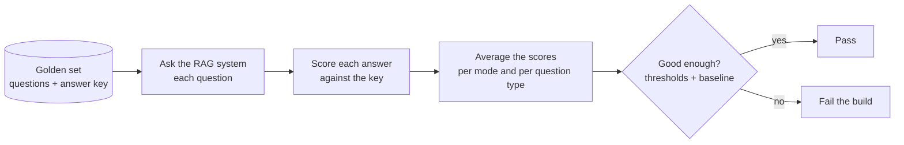
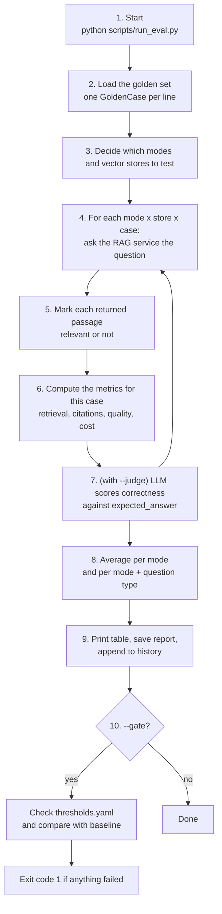
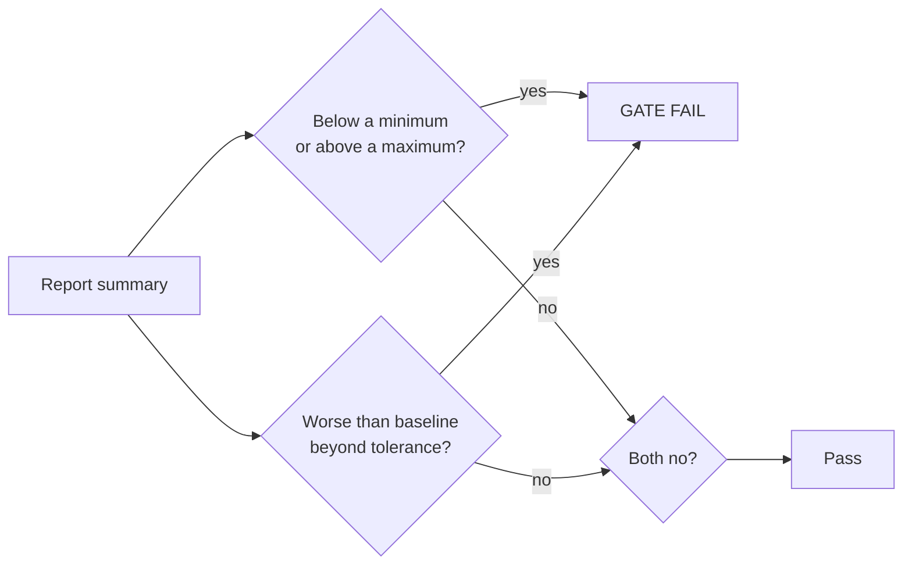
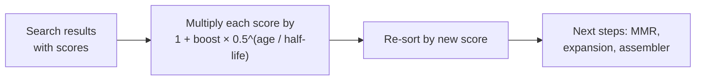

# Evaluation for Beginners: How the Golden Set Turns into Metrics

This guide explains, step by step and in plain language, how this project **measures the quality** of its answers. It covers what a golden set is, what happens when you run an evaluation, and how every metric is calculated, including **recall** and **precision**.

No prior knowledge of evaluation is needed. If you only have five minutes, read sections 1, 5 and 6.

**Contents**

1. [The big picture](#1-the-big-picture)
2. [Key words explained](#2-key-words-explained)
3. [The golden set](#3-the-golden-set)
4. [The evaluation flow, step by step](#4-the-evaluation-flow-step-by-step)
5. [How "relevant" is decided](#5-how-relevant-is-decided)
6. [Retrieval metrics: recall, precision, hit, MRR, nDCG](#6-retrieval-metrics-recall-precision-hit-mrr-ndcg)
7. [Citation metrics](#7-citation-metrics)
8. [Answer-quality metrics (LLM judge)](#8-answer-quality-metrics-llm-judge)
9. [Other metrics: cost, speed, routing, agent](#9-other-metrics-cost-speed-routing-agent)
10. [From per-question scores to one report](#10-from-per-question-scores-to-one-report)
11. [The quality gate](#11-the-quality-gate)
12. [How to run it](#12-how-to-run-it)
13. [Freshness: how newer content is favoured](#13-freshness-how-newer-content-is-favoured)
14. [Things to watch out for](#14-things-to-watch-out-for)
15. [Where to find things in the code](#15-where-to-find-things-in-the-code)

---

## 1. The big picture

A RAG system has two jobs:

1. **Find** the right passages in the documents (retrieval).
2. **Write** a correct answer from them, with citations (generation).

To know whether a change makes the system better or worse, we need a fixed **exam** with known correct answers. That exam is the **golden set**. Every evaluation run asks the system all the golden questions and compares what it did with what it *should* have done.

> **Analogy:** a teacher marking an exam.
> - The **golden set** is the answer key: each question, which pages of the textbook hold the answer, and the model answer.
> - The **RAG system** is the student, sitting the exam.
> - The **metrics** are the marks: "did the student open the right pages?" (retrieval), "did they quote the right pages?" (citations), "is the answer right?" (correctness).



The core code is a single file: [harness.py](../src/app/rag/evaluation/harness.py). The command-line runner is [run_eval.py](../scripts/run_eval.py).

---

## 2. Key words explained

| Word | Simple meaning |
|---|---|
| **Golden set** | A file of test questions with their known correct sources and answers ([evals/golden_set.jsonl](../evals/golden_set.jsonl)) |
| **Case** | One question in the golden set |
| **Retrieved passages** | The passages the system handed to the LLM to write the answer. In the response, these are the `citations` list |
| **Cited passage** | A retrieved passage the answer actually points to with a `[n]` marker |
| **Relevant** | A passage that, according to the answer key, contains the answer |
| **k (top_k)** | How many of the top passages we look at when scoring (default `5`) |
| **Recall** | Of the relevant material, how much did we find? |
| **Precision** | Of what we found, how much was relevant? |
| **LLM judge** | A second LLM call that gives the answer marks from 1 to 5 |
| **Mode** | The retrieval strategy: `semantic`, `hybrid`, `hybrid_graph`, `graph`, `agentic`, or `auto` |
| **Baseline** | A saved earlier report that new runs are compared against |
| **Threshold** | The minimum (or maximum) score a metric must reach to pass |

---

## 3. The golden set

The golden set is a **JSONL** file: one JSON object per line, one question per line. Example from [evals/golden_set.jsonl](../evals/golden_set.jsonl):

```json
{"id": "toy-q1",
 "question": "How many blue balls are in Bag A?",
 "collection": "default",
 "question_type": "factoid",
 "expected_sources": ["toy-room-inventory.pdf"],
 "expected_answer": "Bag A contains 8 blue balls."}
```

| Field | Required? | What it is for |
|---|---|---|
| `question` | Yes | The question to ask |
| `id` | No | A name for the case (`case-<line number>` if missing) |
| `collection` | No | Which document collection to search (default `default`) |
| `question_type` | No | `factoid`, `relationship`, `multi_hop`, `global`, `analytical`, `multi_step` or `unanswerable` (default `factoid`). Used for the per-type scorecards and to work out the expected mode |
| `expected_sources` | One of these two, unless unanswerable | The **files** that hold the answer. Matched by the end of the path, so `"leave.pdf"` matches `policies/hr/leave.pdf` |
| `relevant_chunk_ids` | | The exact **chunk ids** that hold the answer. More precise than `expected_sources` |
| `expected_answer` | No | A model answer. Needed for the **correctness** score |
| `expected_tools` | No | Tools the agent should use (agentic mode only) |
| `expected_mode` | No | The mode the router should pick. If missing, it comes from `question_type` (see 9.3) |

**Unanswerable questions** (`question_type: "unanswerable"`, for example "What is the cafeteria menu for next Friday?") have no expected sources. They test that the system says "I don't know" instead of making something up.

---

## 4. The evaluation flow, step by step



| Step | What happens | Code |
|---|---|---|
| 1 | You run the script, with options such as `--rag-mode all --judge` | [run_eval.py](../scripts/run_eval.py) |
| 2 | Each line of the JSONL becomes a `GoldenCase`. Unknown fields are ignored | `load_golden` |
| 3 | `--rag-mode all` tests every **enabled** mode; one value tests that mode; no value uses the default `RAG_MODE`. `--vector-store all` repeats everything on every configured vector store | `evaluate` |
| 4 | The **real** chat service is called, exactly as the API would, with `include_trace=True` (so we can see the steps) and `evaluate=<--judge>` (so the judge runs). The time taken is measured | `EvalRunner.run_case` |
| 5 | Each passage in the response is checked against the answer key (section 5) | `GoldenCase.is_relevant` |
| 6 | All metrics that need no extra LLM call are computed | `response_metrics` |
| 7 | With `--judge` and an `expected_answer`, one more LLM call scores correctness 1-5 | `score_correctness` |
| 8 | Scores are averaged per mode, and per mode and question type | `summarise`, `summarise_by_type` |
| 9 | A table is printed, the full report is written to `evals/results/latest.json`, and a summary line is appended to `evals/results/history.jsonl` (with the git commit) | `main`, `append_history` |
| 10 | With `--gate`, the averages are checked against limits and the saved baseline | `check_thresholds`, `compare_baseline` |

**Important:** the evaluation does not use a fake or simplified system. It calls the same service the API uses, so it measures what users actually get.

---

## 5. How "relevant" is decided

Every metric starts with one question per passage: **is this passage relevant?** The rule (`GoldenCase.is_relevant`) is:

A passage is relevant if **either**

1. its `chunk_id` is in the case's `relevant_chunk_ids`, **or**
2. its source path **ends with** one of the case's `expected_sources` (backslashes are turned into `/` first).

```
expected_sources = ["toy-room-inventory.pdf"]

passage source "data/sample/toy-room-inventory.pdf"  -> relevant   (ends with it)
passage source "data/sample/office-rules.pdf"        -> not relevant
```

The system's response is then turned into a list of `True` / `False` values, **in the order the passages were given to the LLM**:

```
passages:   [1] toy-room   [2] office-rules   [3] toy-room   [4] canteen
relevance:  [ True,          False,             True,          False ]
```

This list is the input to all the retrieval metrics below.

> **What exactly is the "retrieved list"?** It is the `citations` list of the response. That is the **final** set of passages the LLM saw: after reranking, after the token budget, and after the reorder that puts strong passages at the start and end. By default the assembler keeps only 4 passages (`RETRIEVAL_RERANK_TOP_N=4`). So the evaluation scores what the LLM actually received, not the raw search results.

---

## 6. Retrieval metrics: recall, precision, hit, MRR, nDCG

Code: `retrieval_metrics(relevance, total_relevant, k)` in [harness.py](../src/app/rag/evaluation/harness.py).

### 6.1 The inputs

| Input | Meaning | How it is set |
|---|---|---|
| `relevance` | The True/False list from section 5 | One value per passage |
| `k` | How many top passages to look at | `--top-k`, default `5` |
| `total_relevant` | How many relevant things exist in the answer key | `len(expected_sources)`, or if empty `len(relevant_chunk_ids)` |

First, only the top `k` passages are kept: `top = relevance[:k]`. Then:

- `hits` = how many of `top` are `True`.
- `first` = the position (1, 2, 3...) of the first `True`.

If `total_relevant` is 0 (an unanswerable question), **no retrieval metrics are computed** for that case.

### 6.2 Recall: "did we find what we needed?"

```
recall = hits / total_relevant
```

> Out of everything the answer key says is relevant, what share showed up in the top k?

### 6.3 Precision: "was what we found useful?"

```
precision = hits / len(top)
```

> Out of the passages we gave the LLM (up to k), what share was relevant?

Note that the denominator is the number of passages **actually returned** (at most k), not k itself. If the system returns only 3 passages and k is 5, precision is out of 3.

> **Recall vs precision, in a picture.** You are fishing for 2 red fish in a pond.
> - Your net catches 4 fish: both red ones and 2 grey ones.
> - **Recall** = red fish caught / red fish in the pond = 2 / 2 = **1.0**. You missed nothing.
> - **Precision** = red fish caught / all fish caught = 2 / 4 = **0.5**. Half your catch is useless.
> A huge net gives high recall but low precision. A tiny net gives high precision but may miss fish (low recall). Good retrieval gets both high.

### 6.4 Hit: "did we find anything relevant at all?"

```
hit = 1.0 if hits > 0 else 0.0
```

The simplest metric. Averaged over many questions, it is the **share of questions where at least one relevant passage was retrieved**.

### 6.5 MRR: "how high was the first good passage?"

```
mrr = 1 / first     (0.0 if there is no relevant passage in the top k)
```

| First relevant passage at position | MRR |
|---|---|
| 1 | 1.0 |
| 2 | 0.5 |
| 3 | 0.333 |
| none | 0.0 |

MRR stands for *Mean Reciprocal Rank*: "reciprocal" because it is 1 / rank, "mean" because it is averaged over all questions.

### 6.6 nDCG: "were the good passages near the top?"

nDCG (*normalised Discounted Cumulative Gain*) rewards relevant passages more when they appear earlier.

1. **DCG**: every relevant passage at position *i* earns `1 / log2(i + 1)` points.

   | Position | Points if relevant |
   |---|---|
   | 1 | 1 / log2(2) = 1.000 |
   | 2 | 1 / log2(3) = 0.631 |
   | 3 | 1 / log2(4) = 0.500 |
   | 4 | 1 / log2(5) = 0.431 |
   | 5 | 1 / log2(6) = 0.387 |

2. **Ideal DCG**: the score of a perfect list, where all relevant passages come first. It uses `min(total_relevant, k)` relevant passages.
3. **nDCG** = DCG / ideal DCG. A perfect ranking scores 1.0.

### 6.7 Worked example

Case (using exact chunk ids):

```json
{"question": "How many blue balls are in Bag A?",
 "relevant_chunk_ids": ["c7", "c9"]}
```

The system returns 4 passages, and the answer cites `[1]` and `[2]`:

| Position | chunk_id | Relevant? | Cited in answer? |
|---|---|---|---|
| 1 | c7 | Yes | Yes |
| 2 | c3 | No | Yes |
| 3 | c9 | Yes | No |
| 4 | c12 | No | No |

- `relevance = [True, False, True, False]`, `k = 5`, `total_relevant = 2`
- `top` = all 4 (fewer than k), `hits = 2`, `first = 1`

| Metric | Calculation | Result |
|---|---|---|
| recall | 2 / 2 | **1.0** |
| precision | 2 / 4 | **0.5** |
| hit | hits > 0 | **1.0** |
| MRR | 1 / 1 | **1.0** |
| DCG | 1/log2(2) + 1/log2(4) = 1 + 0.5 | 1.5 |
| ideal DCG | 1/log2(2) + 1/log2(3) = 1 + 0.631 | 1.631 |
| nDCG | 1.5 / 1.631 | **0.92** |

In words: everything needed was found (recall 1.0) and the first passage was a good one (MRR 1.0), but half the passages were noise (precision 0.5) and the second good passage came at position 3 instead of 2 (nDCG 0.92).

---

## 7. Citation metrics

Retrieval metrics look at what the LLM was **given**. Citation metrics look at what the answer actually **pointed to** with `[n]` markers. Code: `citation_metrics`.

A passage counts as *cited* when the answer contains its valid `[n]` marker (a marker pointing to a passage that does not exist is ignored).

```
citation_precision = relevant cited passages / all cited passages
citation_recall    = expected items covered by a citation / number of expected items
```

- **Citation precision:** of the passages the answer cites, how many are actually relevant? Low means the answer cites the wrong sources.
- **Citation recall:** of the expected sources (or chunk ids), how many are cited at least once? Low means the answer left out a source it should have cited. Here each expected **file** counts once, no matter how many of its chunks are cited.

**Same worked example** (answer cites [1] = c7 and [2] = c3; expected `c7`, `c9`):

| Metric | Calculation | Result |
|---|---|---|
| citation_precision | relevant cited (c7) / cited (c7, c3) = 1 / 2 | **0.5** |
| citation_recall | expected ids cited (c7) / expected (c7, c9) = 1 / 2 | **0.5** |

Both are 0.0 if nothing is cited. Like retrieval metrics, they are skipped for unanswerable questions.

---

## 8. Answer-quality metrics (LLM judge)

These need an LLM to read the answer, so they only appear when you run with **`--judge`**.

### 8.1 The answer judge (no answer key needed)

With `--judge`, each chat request is sent with `evaluate: true`. The service then asks an LLM judge ([judge.py](../src/app/rag/evaluation/judge.py)) to score the answer from 1 (poor) to 5 (excellent) on:

| Metric in the report | Judge criterion | Question it answers |
|---|---|---|
| `faithfulness` | groundedness | Is every claim in the answer supported by the passages? (Catches made-up facts) |
| `answer_relevance` | answer relevance | Does the answer actually address the question? |
| `context_relevance` | context relevance | Did the passages contain what was needed? |

The judge only runs when `QUALITY_JUDGE` is `request` (the default) or `always`, and only for real answers (not "not found" replies).

### 8.2 Correctness (needs `expected_answer`)

A separate LLM call compares the generated answer with the case's `expected_answer` and scores **correctness** 1-5 (5 = same facts and nothing wrong, 3 = partly correct, 1 = wrong or missing). For an unanswerable question, saying "the information is not available" counts as correct.

### 8.3 Signals with no LLM

These come from simple text checks on every answer ([signals.py](../src/app/rag/evaluation/signals.py)):

| Metric | How it is calculated |
|---|---|
| `citation_coverage` | Share of the answer's statements (sentences of 4+ words) that carry at least one `[n]` marker |
| `answered` | 1.0 if the answer is not empty, not the standard "not found" text, and not a refusal like "I could not find..." without citations |
| `abstained` | **Unanswerable questions only.** 1.0 if the system correctly said it did not know. Higher is better |

---

## 9. Other metrics: cost, speed, routing, agent

### 9.1 Cost and speed

| Metric | Meaning |
|---|---|
| `latency_ms` | Total time for the question, measured around the chat call |
| `retrieval_ms` | Time spent in vector-store searches (from the trace steps `vector_search`, `document_search`, `vector_seed`) |
| `tokens` | Total LLM tokens used for the answer |

### 9.2 Agent metrics (agentic mode only)

| Metric | Meaning |
|---|---|
| `agent_steps` | Number of trace steps |
| `agent_tool_calls` | Number of tool calls the agent made |
| `agent_redundant_calls` | Calls that repeated the same tool with the same query |
| `agent_looped` | 1.0 if the agent searched more than once |
| `tool_selection` | 1.0 if every tool in `expected_tools` was used (only when the case lists them) |

### 9.3 Routing accuracy (`auto` mode)

When you run with `--rag-mode auto` (or no mode), the router picks a strategy for each question. `routing_accuracy` is 1.0 when it picked the **expected mode**:

- `expected_mode`, if the case sets it, otherwise
- from `question_type`:

| question_type | Expected mode |
|---|---|
| `factoid`, `unanswerable` | `hybrid` |
| `relationship`, `multi_hop`, `global` | `graph` |
| `analytical`, `multi_step` | `agentic` |

---

## 10. From per-question scores to one report

Each case produces a dictionary of metrics. These are then **averaged**:

```
summary[metric] = average of that metric over the cases that HAVE it
```

A case that lacks a metric is left out of that metric's average instead of counting as 0. For example, unanswerable cases have no `recall`, so they do not drag recall down, and only unanswerable cases contribute to `abstained`.

Two views are produced for every mode (and vector store):

| View | What it shows | Why |
|---|---|---|
| `summary` | Averages over all cases | One score per mode, for quick comparison |
| `by_type` | Averages per `question_type` | Fair scorecards: graph mode should be judged mainly on relationship questions, agentic on analytical ones |

The report also includes `cases`: the raw metrics and answer for every single case, to debug a bad score.

**Example printed table** (`--rag-mode all`, values made up):

```
mode                  hit       recall    precision          mrr  ...
semantic            0.900        0.850        0.450        0.780  ...
hybrid              0.950        0.900        0.500        0.850  ...
graph               0.700        0.650        0.400        0.600  ...
  [hybrid/factoid] hit=1.00 n=6
  [graph/relationship] hit=1.00 n=1
```

---

## 11. The quality gate

With `--gate`, the run **fails** (exit code 1) if quality drops. Run it against QA before promoting a release ([workflow-execution.md, section 6](../docs/workflow-execution.md#6-everyday-change-commit-to-production)). There are two checks.

### 11.1 Thresholds (absolute limits)

[evals/thresholds.yaml](../evals/thresholds.yaml):

```yaml
all:                 # applies to every mode
  hit: 0.7
  recall: 0.6
  citation_precision: 0.6
  faithfulness: 3.5
  answer_relevance: 3.5
  latency_ms_max: 15000
semantic:
  mrr: 0.5
graph:
  hit: 0.5           # overrides "all" for graph
agentic:
  tokens_max: 60000
  agent_redundant_calls_max: 0.5
```

- A plain name is a **minimum**: `recall: 0.6` fails if average recall is below 0.6.
- A name ending in `_max` is a **maximum**: `latency_ms_max: 15000` fails if average latency is above 15 seconds.
- Mode sections override `all`. A run on a named store (`semantic@mongo`) uses the `semantic` rules.
- A metric missing from the report is skipped (for example `faithfulness` without `--judge`).

### 11.2 Baseline (no regressions)

`--save-baseline` saves the current report as `evals/results/baseline.json`. Later `--gate` runs compare each metric with it:

| Metric kind | Fails when |
|---|---|
| Higher is better (recall, precision, hit, ...) | New value < baseline − 0.02 |
| Lower is better (`latency_ms`, `retrieval_ms`, `tokens`, `agent_redundant_calls`, `agent_steps`) | New value > baseline × 1.02 |

The small 0.02 tolerance stops tiny random changes from failing the build.



---

## 12. How to run it

```bash
# Every enabled mode, top 5 passages
make eval

# Every mode on every vector store, with the LLM judge
make eval-vector

# One mode, with the judge
python scripts/run_eval.py --rag-mode hybrid --judge

# Test the router
python scripts/run_eval.py --rag-mode auto

# Quality gate: thresholds + baseline
python scripts/run_eval.py --rag-mode all --gate

# Record the current results as the new baseline
python scripts/run_eval.py --rag-mode all --save-baseline
```

| Option | Default | Meaning |
|---|---|---|
| `--golden` | `evals/golden_set.jsonl` | The golden set file |
| `--rag-mode` | `RAG_MODE` | A mode, or `all` for every enabled mode |
| `--vector-store` | `VECTOR_STORE_PROVIDER` | `mongo`, or `all` |
| `--top-k` | `5` | k for the retrieval metrics |
| `--judge` | off | Turn on the LLM judge and correctness |
| `--gate` | off | Fail on threshold violations or regressions |
| `--thresholds` | `evals/thresholds.yaml` | The limits file |
| `--save-baseline` | off | Save this run as the baseline |
| `--output` | `evals/results/latest.json` | Where the full report is written |

The documents in the golden set must already be **ingested** into the collection, otherwise every retrieval metric is 0.

**Related tools** (same idea, different targets):

- [run_ablation.py](../scripts/run_ablation.py): runs the same golden set over several configuration variants from [evals/ablations.yaml](../evals/ablations.yaml) (chunk size, rerankers, graph settings...) and compares them side by side.
- [eval_graph.py](../scripts/eval_graph.py): graph-only checks: precision and recall of extracted entities and relations, entity-linking accuracy and Cypher template choice, each against its own gold file in `evals/`.

---

## 13. Freshness: how newer content is favoured

**Important first:** the evaluation harness does **not** calculate a "freshness" metric. No freshness score appears in the report or in `thresholds.yaml`. In this project, freshness is handled while **answering**, in four places:

| # | Where | What it does | On by default? |
|---|---|---|---|
| 1 | Ingestion: `effective_date` | Gives every document a "valid from" date | Yes |
| 2 | Retrieval: **recency boost** | Raises the score of newer documents | **No** (`SEMANTIC_RECENCY_BOOST=0.0`) |
| 3 | Answer prompt | Tells the LLM to prefer the most recent passage when passages disagree | Yes |
| 4 | Answer cache | Clears saved answers when a collection is re-ingested | Only if the cache is on |

### 13.1 Where the date comes from (`effective_date`)

During ingestion ([metadata.py](../src/app/rag/ingestion/metadata.py)), each document gets an `effective_date`. The first one found wins:

1. An `effective_date` given by the source (connector metadata).
2. A date found in the **first 5,000 characters** of the text after words like *effective*, *valid from*, *in force from*, *approved on* or *issued on*. For example, "Effective date: 1 March 2024" gives `2024-03-01`.
3. The file's **last-modified** date.
4. If still empty and AI enrichment is on, a date suggested by the LLM's document profile.

Every chunk of the document carries this date. The date is also shown to the LLM with each passage.

### 13.2 The recency boost formula

Code: `recency_factor` in [strategies/semantic.py](../src/app/rag/strategies/semantic.py).

```
age_days        = today - effective_date            (in days, never below 0)
recency_factor  = 1 + boost × 0.5 ^ (age_days / half_life_days)
new_score       = search_score × recency_factor
```

| Setting | Default | Meaning |
|---|---|---|
| `SEMANTIC_RECENCY_BOOST` | `0.0` (off) | The **maximum** extra weight. `0.3` means a document dated today scores up to 30% higher |
| `SEMANTIC_RECENCY_HALF_LIFE_DAYS` | `365` | After this many days, the extra weight is cut in **half** |

In plain words: a brand-new document gets the full bonus. Every *half-life* (one year by default), the bonus halves. Very old documents get almost no bonus, but they are **never penalised** below their normal score (the factor never drops below 1.0).

**Bonus by age** (`boost = 0.3`, half-life 365 days):

| Document age | Calculation | Factor |
|---|---|---|
| Today | 1 + 0.3 × 0.5^0 | **1.30** (+30%) |
| 6 months | 1 + 0.3 × 0.5^0.5 | **1.21** |
| 1 year | 1 + 0.3 × 0.5^1 | **1.15** |
| 2 years | 1 + 0.3 × 0.5^2 | **1.075** |
| 3 years | 1 + 0.3 × 0.5^3 | **1.04** |
| 10 years | 1 + 0.3 × 0.5^10 | **≈ 1.00** |



### 13.3 Worked example

Two versions of the leave policy match the question "How many days of annual leave do I get?". The boost is `0.3` and the half-life is 365 days.

| Passage | Search score | effective_date age | Factor | New score |
|---|---|---|---|---|
| Leave policy **2021** | 0.80 | 3 years | 1 + 0.3 × 0.125 = 1.0375 | **0.83** |
| Leave policy **2024** | 0.75 | today | 1 + 0.3 × 1 = 1.30 | **0.975** |

Without the boost, the old policy ranks first, because its wording happens to match the question better. With the boost, the current policy moves to the top.

### 13.4 Rules and limits of the boost

- **Where it applies:** inside the `semantic` and `hybrid` search, right after search and before MMR (the diversity step). The same search is reused by the graph fallback, the hybrid side of `hybrid_graph` and the agent's vector tool, so the boost applies there too. Graph-only results (facts, graph chunks, community reports) are **not** boosted.
- **No date, or a date it cannot read:** factor 1.0 (no change).
- **A date in the future:** age is treated as 0, so it gets the full bonus.
- **Order of steps:** the reranker in the assembler runs **after** the boost. A real reranker scores passages again from scratch and can undo the boost. The default reranker (`none`) keeps the boosted order.

### 13.5 The other freshness safeguards

- **The prompt** ([rag_answer.yaml](../src/app/prompts/rag_answer.yaml)): if passages disagree, the LLM is told to point out the conflict, cite both and prefer the most recent one. It can do this because every passage shows its date.
- **Duplicates at ingestion:** when near-identical documents are found, the newest one is kept.
- **Answer cache:** when a collection is re-ingested, its cached answers are deleted, so users do not get an answer built from old content. Cached answers also expire after `ANSWER_CACHE_TTL_SECONDS` (1 hour).

### 13.6 How to check freshness with the golden set

There is no built-in metric, but you can test it with ordinary cases. Ingest an old and a new version of a document, then add a case whose answer key points **only to the new version**:

```json
{"id": "fresh-q1",
 "question": "How many days of annual leave do I get?",
 "question_type": "factoid",
 "expected_sources": ["policies/leave-2024.pdf"],
 "expected_answer": "25 days."}
```

Then the normal metrics measure freshness:

- **MRR** shows whether the new version ranks first.
- **precision** drops if the old version also takes up slots.
- **correctness** (with `--judge`) drops if the answer quotes the old number.

Run it with `SEMANTIC_RECENCY_BOOST=0` and then `0.3` (or as two variants in [ablations.yaml](../evals/ablations.yaml)) to see whether the boost helps.

---

## 14. Things to watch out for

1. **Recall and nDCG can go above 1.0 when you use `expected_sources`.** `total_relevant` counts **files**, but `hits` counts **passages**. If the answer key lists one file and three of its chunks are retrieved, recall = 3 / 1 = **3.0**:

   ```
   expected_sources = ["toy-room-inventory.pdf"]          -> total_relevant = 1
   relevance        = [True, True, False, True]           -> hits = 3
   recall           = 3 / 1 = 3.0     nDCG = 2.06
   ```

   Precision, hit and MRR are not affected. For exact recall, list `relevant_chunk_ids` and leave `expected_sources` empty (if both are set, `total_relevant` uses the number of files). Keep this in mind when reading averages and thresholds.
2. **The scored list is short.** By default only 4 passages reach the LLM (`RETRIEVAL_RERANK_TOP_N=4`), so `--top-k 5` effectively scores 4.
3. **Order is the final order.** The assembler moves strong passages to the start and end, so MRR and nDCG reflect that order, not the raw search ranking.
4. **Judge scores need `--judge`.** Without it, `faithfulness`, `answer_relevance` and `correctness` are missing and their thresholds are skipped silently.
5. **The golden set is small.** It has 14 cases today. One case changing can move an average by 7 percentage points, so add more cases before trusting small differences.
6. **The judge is an LLM.** Its scores can vary between runs. [human_labels.jsonl](../evals/human_labels.jsonl) holds human scores to check the judge against.

---

## 15. Where to find things in the code

| I want to understand... | Open |
|---|---|
| Golden set format, all metric formulas, gate, baseline | [evaluation/harness.py](../src/app/rag/evaluation/harness.py) |
| The command-line runner and its options | [scripts/run_eval.py](../scripts/run_eval.py) |
| The LLM judge prompt | [evaluation/judge.py](../src/app/rag/evaluation/judge.py) |
| Citation coverage and "answered" signals | [evaluation/signals.py](../src/app/rag/evaluation/signals.py) |
| The golden set | [evals/golden_set.jsonl](../evals/golden_set.jsonl) |
| Pass/fail limits | [evals/thresholds.yaml](../evals/thresholds.yaml) |
| Unit tests for the metrics | [tests/unit/test_evaluation.py](../tests/unit/test_evaluation.py) |
| Recency boost (freshness) | [strategies/semantic.py](../src/app/rag/strategies/semantic.py) (`recency_factor`) |
| Where `effective_date` comes from | [ingestion/metadata.py](../src/app/rag/ingestion/metadata.py) |
| The quality gate | [scripts/run_eval.py](../scripts/run_eval.py) (`--gate`) |

---

## Quick recap

1. **Golden set:** questions plus an answer key (which files or chunks hold the answer, and optionally the model answer).
2. **Run:** each question goes through the real chat service, in each mode you choose.
3. **Mark:** each passage the LLM received is marked relevant or not, by chunk id or by source file.
4. **Score:** recall = relevant found / relevant expected; precision = relevant found / passages returned; plus hit, MRR, nDCG, citation scores, judge scores, cost and speed.
5. **Report:** average per mode and per question type, save it and append it to the history.
6. **Gate:** fail the build if a score is below its threshold or worse than the baseline.
7. **Freshness** is not a metric. It is a ranking boost while answering: score × (1 + boost × 0.5^(age / half-life)). It is off by default, and you can test it with golden cases that point to the newest version.
