# Graph RAG for Beginners: How Ingestion and Retrieval Work

This guide explains, step by step and in plain language, how this project turns documents into a **knowledge graph** (ingestion) and how it uses that graph to answer questions (retrieval).

No prior knowledge of RAG or graphs is needed. If you only have five minutes, read sections 1, 2 and 6.

**Contents**

1. [The big picture](#1-the-big-picture)
2. [Key words explained](#2-key-words-explained)
3. [What the graph looks like](#3-what-the-graph-looks-like)
4. [Ingestion: from document to graph](#4-ingestion-from-document-to-graph)
5. [Maintenance: building the "big picture" summaries](#5-maintenance-building-the-big-picture-summaries)
6. [Retrieval: from question to answer](#6-retrieval-from-question-to-answer)
7. [Security: who can see what](#7-security-who-can-see-what)
8. [Settings you will touch most](#8-settings-you-will-touch-most)
9. [Where to find things in the code](#9-where-to-find-things-in-the-code)
10. [Step-by-step workflow with one worked example](#10-step-by-step-workflow-with-one-worked-example)
11. [Common questions](#11-common-questions)

---

## 1. The big picture

### What is RAG?

**RAG** means *Retrieval-Augmented Generation*. A language model (LLM) does not know your company documents. So, before it answers, we:

1. **Retrieve**: find the passages in your documents that are relevant to the question.
2. **Generate**: give those passages to the LLM and ask it to answer using only them, with citations.

Think of an **open-book exam**: the LLM is the student, the retrieved passages are the pages of the book we open for it.

### What is *Graph* RAG?

Normal ("semantic") RAG finds passages that *sound similar* to the question. That works well for "What is the leave policy?" but struggles with:

- **Relationship questions**: "How is the Data Office related to the Privacy Policy?"
- **Big-picture questions**: "What are the main themes across all our documents?"

**Graph RAG** adds a map of the knowledge: *things* (people, policies, systems...) and *how they connect*. The system can then follow connections instead of only matching words.

> **Analogy:** a library.
> - Normal RAG = a librarian who finds the books whose text looks most like your question.
> - Graph RAG = that librarian **plus** a wall-size mind map showing how all the topics link up, and short summaries of each cluster of topics.

### The two halves

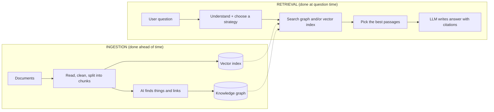

- **Ingestion** = preparing the library. Slow, runs when documents are added or changed.
- **Retrieval** = answering a visitor's question. Must be fast.

---

## 2. Key words explained

| Word | Simple meaning | Example |
|---|---|---|
| **Document** | A source file | `leave-policy.pdf` |
| **Chunk** | A small piece of a document (about 800 tokens, roughly a page-half) | One section about "Sick leave" |
| **Embedding / vector** | A list of numbers that captures the *meaning* of a text, so similar meanings are close together | "holiday" and "vacation" get close numbers |
| **Vector store** | A database that finds chunks by meaning. Here: MongoDB Atlas Vector Search | "Find chunks about time off" |
| **Entity** | A *thing* mentioned in the text | "HR Department", "Leave Policy" |
| **Relation** | A *link* between two entities | HR Department **owns** Leave Policy |
| **Claim** | A dated fact about an entity (optional) | "Leave Policy was updated on 2024-01-01" |
| **Knowledge graph** | All the entities (dots) and relations (lines) together. Here stored as MongoDB collections | A map of dots and lines |
| **Ontology** | The rulebook of allowed entity and relation types (`config/ontology.yaml`) | Allowed: Person, Policy, System. Allowed links: OWNS, MANAGES |
| **Community** | A cluster of closely connected entities | All entities about "Leave & Benefits" |
| **Community report** | An AI-written summary of one community | "This group covers leave rules, who approves them..." |
| **Hop** | One step along a line in the graph | A to B is 1 hop, A to C via B is 2 hops |
| **ACL** | *Access control list*: who is allowed to see a piece of content | `["hr-team"]` or `*` (everyone) |
| **Manifest** | A ledger recording what was ingested and its status | "leave-policy.pdf: graphed, 12 chunks" |
| **Utility model** | The LLM used for background jobs (extraction, analysis). The LLM gateway picks it | |
| **Chat model** | The LLM that writes the final answer. The LLM gateway picks it too | |

---

## 3. What the graph looks like

Each chunk is saved together with the entities it mentions and how they connect.

Example text: *"The HR Department owns the Leave Policy. The Leave Policy applies to all employees."*

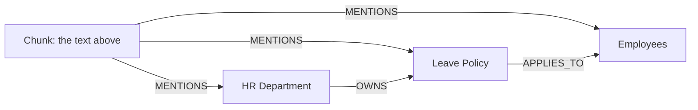

The graph has two layers:

| Layer | What it holds | Why |
|---|---|---|
| **Structure layer** | Document → Section → Chunk, plus "next chunk" links | Remembers where text came from and its order |
| **Meaning layer** | Entities, the links between them, and (optionally) claims | Lets us follow relationships |

Every link remembers **which chunk it came from**, so any fact the system finds can be traced back to a real source and cited.

---

## 4. Ingestion: from document to graph

**How to start it:** the API (`POST /api/v1/ingestion` or `/ingestion/upload`), the command line (`scripts/ingest_cli.py`), or the scheduled reconcile (`scripts/reconcile.py`). They all run the same pipeline: [pipeline.py](../src/app/rag/ingestion/pipeline.py).

The graph is built only when `graph` is one of the **targets** (`INGESTION_TARGETS=vector,graph`). The code default is `vector` only; `.env.example` turns the graph on.

### 4.1 The pipeline in one picture

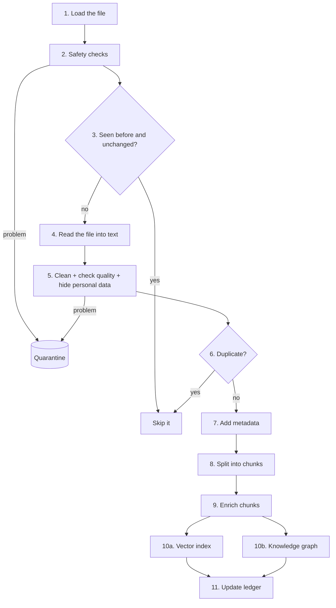

### 4.2 Each step in plain words

| Step | What happens | Why it matters |
|---|---|---|
| 1. Load | A **connector** reads the file from local disk, Confluence, a website, a REST API or a database | One pipeline for many sources |
| 2. Safety checks | File size, malware and retention rules are checked | Bad files go to **quarantine** with a reason, and never reach the index |
| 3. Change check | The **manifest** is consulted. Same content and same pipeline version? Skip. Only permissions changed? Just update permissions | Saves time and AI cost |
| 4. Parse | The file (PDF, Word, Excel, HTML, ...) is turned into text, headings and tables. Attachments are processed too. Images and audio are not ingested | LLMs need text |
| 5. Clean and govern | Noise removed, parse quality and sensitivity checked, prompt-injection attempts caught, **personal data (PII) masked** when `PII_MODE` is set (default `off`) | Protects privacy before any AI sees the text |
| 6. Duplicate check | Exact copies and near-copies are skipped (newest wins) | Avoids repeating the same answer |
| 7. Metadata | Adds a stable `doc_id`, title, document type, dates, tags and ACL | Enables filtering and security |
| 8. Chunk | Splits text into pieces, usually following headings (`CHUNK_STRATEGY=structure`) or topic shifts (`semantic`); neighbours overlap a little | Pieces small enough to search precisely |
| 9. Enrich | Optional AI extras: a short context line, sample questions, and a summary per chunk | Helps search find the right chunk |
| 10a. Vector index | Each chunk is turned into an embedding and saved; older versions of that file are deleted *after* the new ones are saved | Finds chunks by meaning |
| 10b. Knowledge graph | See 4.3 | Finds chunks by relationships |
| 11. Ledger | The manifest records status (`indexed` or `graphed`), counts and version | Lets the next run skip unchanged files |

Every intermediate result is also saved in folders under `.ragdata/` (`raw`, `parsed`, `clean`, `chunks`, `quarantine`), which is handy for debugging.

**If a file fails:** it is recorded as `failed` (or quarantined) and the run continues with the other files. One bad file never stops everything.

### 4.3 Step 10b in detail: building the graph

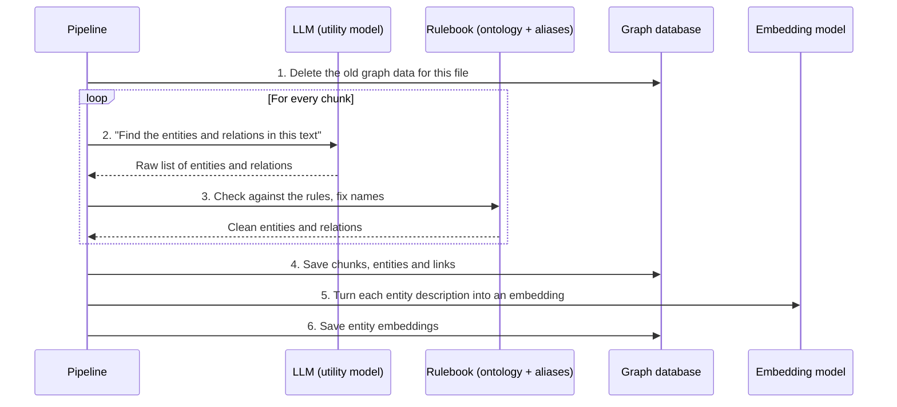

What each step really does ([extraction.py](../src/app/rag/graph/extraction.py), [ontology.py](../src/app/rag/graph/ontology.py)):

1. **Start clean.** Old graph data for this file is removed, so re-running never creates duplicates.
2. **Ask the LLM.** For each chunk it is given the allowed types plus a few examples, and returns entities (name, type, short description) and relations (source, target, type, and a **weight** from 0 to 1 saying how clearly the text states it). The text is treated as *data*, so any instructions hidden inside it are ignored.
3. **Validate and tidy up.**
   - Types are matched to the ontology (synonyms are remapped; unknown types become `Concept` / `RELATED_TO`, or are dropped in strict mode).
   - A relation must connect two entities the LLM actually listed.
   - **Alias resolution** merges different spellings into one entity. Built-in name normalisation (case, legal suffixes such as Inc./Corp/Ltd, a leading "the") makes "ACME Inc." and "Acme" the same node. `config/entity_aliases.yaml` adds explicit aliases on top (for example "HR" for "Human Resources").
   - Limits: at most 25 entities and 40 relations per chunk.
4. **Save** the chunk, its entities and the links into the graph. Saving uses "merge" (create if missing, reuse if present), so the same entity from different chunks becomes **one node**. That is what connects the graph across documents.
5. **Embed entities.** Each entity's text (`name (type): description`) is converted to an embedding so a question can later be matched to an entity by *meaning*, not just by exact name.

Optional extra accuracy: `GRAPH_GLEANING_ROUNDS` asks the LLM "did you miss anything?", and `GRAPH_EXTRACT_CLAIMS` also extracts dated claims. Results are cached in memory (per process, keyed by chunk text, ontology version and these settings), so an unchanged chunk is not re-sent to the LLM within the same run or worker. The cache does not survive a restart.

### 4.4 Re-runs and deletions

- **Re-ingesting** an unchanged file does nothing.
- **Changed file:** its vector and graph data are replaced.
- **Full sync** (`full_sync=True`): files that disappeared from the source are deleted from both the vector index and the graph.
- At the end of a run, stored chunk counts are compared with what was written (**reconciliation**) to catch silent problems.

---

## 5. Maintenance: building the "big picture" summaries

Ingestion builds the dots and lines. A separate job builds the **summaries** needed for big-picture questions. Run it after large ingests or nightly:

```
python scripts/graph_maintenance.py all --collection default
```

| Task | In plain words |
|---|---|
| `resolve` | Merge entities that are clearly the same thing but spelled slightly differently (name similarity of 90% or more, same type) |
| `embed` | Recompute the entity embeddings |
| `communities` | 1) Score how important each entity is (**PageRank**, the same idea Google used for web pages). 2) Group the graph into clusters of closely connected entities (the **Louvain** method), at up to 3 levels from small and detailed to large and broad. 3) Ask the LLM to write a **report** for each cluster with at least `GRAPH_COMMUNITY_MIN_SIZE` members. 4) Save the reports in the vector store, marked `kind=community`. Steps 3 and 4 need an LLM, a vector store and an embedder |
| `quality` | Print counts, entities with no links, possible duplicates and sample facts so a person can review the graph |

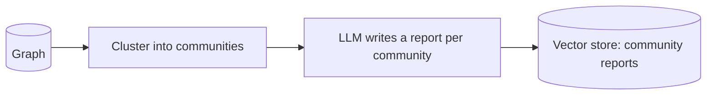

Those reports are what the **global** search mode reads later.

---

## 6. Retrieval: from question to answer

**How to start it:** `POST /api/v1/chat` (full answer) or `POST /api/v1/retrieval` (just the passages). The conductor is `RetrievalService` in [retrieval_service.py](../src/app/services/retrieval_service.py).

### 6.1 The whole journey

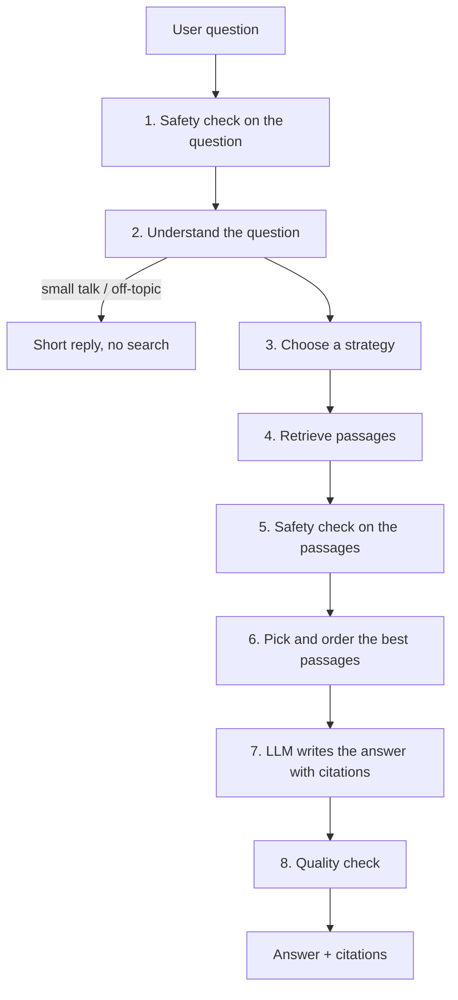

| Step | What happens |
|---|---|
| 1. Input safety | Unsafe or malicious questions are blocked |
| 2. Understand | One cheap LLM call rewrites follow-ups into a **standalone question** (using chat history), fixes typos, detects the **intent** (needs knowledge base / small talk / off-topic), classifies the **complexity** and reads filters you typed (for example "policies from 2023"). Acronyms are expanded using `config/glossary.yaml` ("HR" becomes "HR (Human Resources)"). In `/chat`, small talk gets a short LLM reply and off-topic questions a canned reply, with no search |
| 3. Choose a strategy | The **router** decides how to search (see 6.2) |
| 4. Retrieve | The chosen strategy gathers passages (6.3 and 6.4) |
| 5. Passage safety | Passages that look like prompt-injection attacks are dropped |
| 6. Assemble | Remove duplicates, **rerank** (put the most relevant first; the default reranker `none` just sorts by score), keep the top `RETRIEVAL_RERANK_TOP_N` (default 4), optionally drop weak results (off by default), fit into the token budget, and place the strongest passages at the start and end, because LLMs pay less attention to the middle |
| 7. Generate | The chat model answers using only the numbered passages and cites them. No passages means a polite "not found" |
| 8. Check | Looks at how well the answer is supported. If confidence is low and **escalation** is on (`RAG_ESCALATION_ENABLED`), it retries with a stronger strategy |

For `/chat`, an optional cache (`ANSWER_CACHE_ENABLED`, off by default) can return a saved answer immediately for a repeated question, scoped to the user's permissions.

### 6.2 Choosing a strategy (the router)

The router runs only when the mode is `auto` (`RAG_MODE=auto`, or `rag_mode=auto` on the request). Out of the box `RAG_MODE=semantic` and only `semantic` is enabled, so **to use the graph you must enable the graph modes and set `RAG_MODE=auto`** (or request `graph` / `hybrid_graph` directly).

In `auto` mode the router looks at the question's **complexity**:

| Question type | Example | Strategy used |
|---|---|---|
| `simple` (a fact) | "How many sick days do I get?" | `hybrid` (meaning + keyword search) |
| `relationship` | "How is the Data Office related to the Privacy Policy?" | `graph` |
| `global` (themes) | "What are the main themes across the policies?" | `graph` |
| `multi_step` | "Compare leave rules in two countries and summarise differences" | `agentic` (an agent that plans several searches) |

You can also force a mode per request (`rag_mode`) or set the default (`RAG_MODE`). Only modes listed in `RAG_ENABLED_MODES` are available. In `auto` mode, if the preferred strategy is off, the closest enabled one is used. Asking explicitly for a mode that is not enabled returns an error.

The available modes are `semantic`, `hybrid`, `hybrid_graph`, `graph` and `agentic`. This document focuses on the two graph ones.

### 6.3 The `graph` strategy

Code: [strategies/graph.py](../src/app/rag/strategies/graph.py)

**Step A: find the entities in the question.** An LLM pulls out the specific entities ("Leave Policy") and up to 3 broad themes ("employee benefits").

**Step B: link them to the graph ("entity linking").** The system looks for matching graph entities by exact name, alias and partial match (the entity name contains the term). If that finds fewer than 2 entities and an embedder is available, it also matches by *meaning* using the entity embeddings (similarity at least 0.75). Only entities the user is allowed to see are returned.

**Step C: pick a search mode.** With `GRAPH_SEARCH_MODE=auto` it chooses from the question:

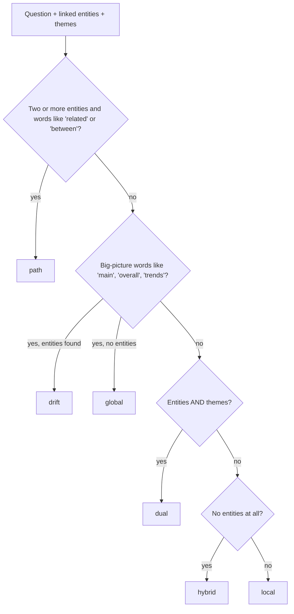

The `drift`, `global`, `dual` and `hybrid` branches are only taken when a vector store is available (and `global` and `hybrid` also need an embedder). Without one, the question ends up in `local`. `auto` never picks `cypher`; it must be forced.

| Mode | What it does, in plain words | Good for |
|---|---|---|
| **local** | Starts at the matched entities, walks outward along the links (up to `GRAPH_MAX_HOPS`, default 2), ranks what it found by importance (personalised PageRank), and returns the facts plus the chunks that mention those entities | "What does the Leave Policy apply to?" |
| **path** | Finds the shortest chain of links between two entities (up to 3 chains) | "How is A related to B?" |
| **hybrid** | No entity was named, so it first does a normal meaning search, looks at which entities those chunks mention, and then uses them as starting points for a local search | Vague questions |
| **global** | Searches the **community reports** (section 5). The LLM scores the useful points in each report from 0 to 100 (this is the "map" step), and the best are returned. Broad questions use the broad, high-level communities | "What are the main themes?" |
| **drift** | Global first, then follows up with local searches on the key entities found in the top reports | Broad question that mentions a specific thing |
| **dual** | Local search on the entities **plus** global search on the themes | Specific and broad at once |
| **cypher** | Runs a pre-approved database query for structured questions such as counts and lists (Cypher is the graph query language). Free-form AI-written queries are blocked when permissions are enforced, unless `GRAPH_ALLOW_FREEFORM_CYPHER=true`. If nothing is returned, it switches to `local` | "How many policies does HR own?" |

**Step D: build the context.** The first passage is a short **"Knowledge graph facts"** summary, such as:

```
Knowledge graph facts:
- HR Department (Organisation): Manages people policies
- HR Department -[OWNS]-> Leave Policy: HR is responsible for the policy
```

It carries a list of the chunks the facts came from (so they can be cited), and the real chunks follow it.

**Fallback:** if the graph finds nothing (or the graph database errors during the search), the system falls back to normal hybrid search (`GRAPH_SEMANTIC_FALLBACK=true`; the trace step is `fallback_semantic`), so you still get an answer.

### 6.4 The `hybrid_graph` strategy

Code: [strategies/hybrid_graph.py](../src/app/rag/strategies/hybrid_graph.py)

This runs **two searches at the same time** and combines them:

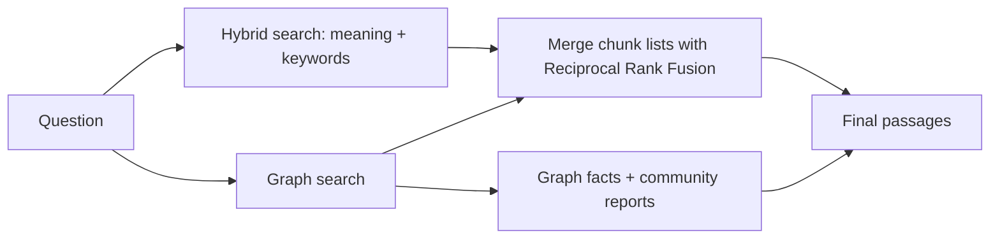

- **Reciprocal Rank Fusion (RRF)** merges two ranked lists by position, not by score, so lists with different scoring scales can be combined. A chunk found by *both* searches rises to the top.
- Graph facts and community reports are not chunks, so they are kept **in front** of the merged chunks.
- If the graph side fails or finds nothing, the hybrid results are used alone. The trace records this (`graph_failed` or `graph_chunks=0`).

### 6.5 Seeing what happened (trace)

Send `include_trace=true` to see the steps taken, for example `query_analysis`, `router`, `query_entities`, `entity_lookup`, `graph_mode`, `graph_traversal`, `linked_chunks`, `fuse_hybrid_graph` and `assemble_context`. This is the best way to understand why a particular answer was produced.

---

## 7. Security: who can see what

- Every chunk, entity-to-entity link (`RELATED`) and claim stores its **ACL** (who may read it). Structural links (`MENTIONS`, `PART_OF`, `NEXT`) do not; they are protected through the chunk they start from.
- Every graph search is filtered by the caller's permissions. An entity is visible only if a chunk the caller can read mentions it.
- If only a file's permissions change, they are updated everywhere **without** re-running the AI extraction.
- **Community reports** blend facts from many documents, so they are built only from content visible to `GRAPH_COMMUNITY_ACL_SCOPE` (default `*`, meaning public). Restricted content cannot leak into a report everyone can read.
- Free-form Cypher is disabled when permissions are enforced (unless `GRAPH_ALLOW_FREEFORM_CYPHER=true`).
- User-supplied values sent to the graph database are passed as parameters, not pasted into query text, which prevents injection. Only numbers (limits) and validated property names and labels are formatted into queries.
- When `PII_MODE` is on, personal data is masked **before** chunking and before any LLM sees the text. It is `off` by default.

---

## 8. Settings you will touch most

Set in the `.env` file (see [.env.example](../.env.example) for all options). "Default" is the value in the code ([config.py](../src/app/core/config.py)) when the setting is not set. Where `.env.example` sets a different value, it is shown in brackets.

| Setting | Default | What it changes |
|---|---|---|
| `INGESTION_TARGETS` | `vector` (`.env.example`: `vector,graph`) | Which stores are filled during ingestion |
| `PII_MODE` | `off` | Mask personal data before chunking |
| `CHUNK_SIZE` / `CHUNK_OVERLAP` | `800` / `120` | Size of chunks and how much neighbours overlap |
| `GRAPH_ONTOLOGY_PATH` | `config/ontology.yaml` | Allowed entity and relation types |
| `GRAPH_ALIASES_PATH` | `config/entity_aliases.yaml` | Which names mean the same entity |
| `GRAPH_GLEANING_ROUNDS` | `0` | Extra "did you miss anything?" passes (more accurate, more cost) |
| `GRAPH_EXTRACT_CLAIMS` | `false` | Also extract dated claims |
| `RAG_MODE` | `semantic` (`.env.example`: `hybrid`) | Default retrieval strategy (`auto` lets the router choose) |
| `RAG_ENABLED_MODES` | `semantic` (`.env.example`: all five) | Strategies that may be used |
| `GRAPH_SEARCH_MODE` | `auto` | Force `local`, `path`, `global`, etc. |
| `GRAPH_MAX_HOPS` | `2` | How far to walk from an entity |
| `GRAPH_MAX_ENTITIES` / `GRAPH_MAX_RELATIONS` | `10` / `40` | How much of the graph to read per question |
| `GRAPH_COMMUNITY_LEVELS` / `GRAPH_COMMUNITY_MIN_SIZE` | `3` / `3` | How communities are built |
| `GRAPH_SEMANTIC_FALLBACK` | `true` | Use normal hybrid search if the graph finds nothing |
| `RAG_ESCALATION_ENABLED` | `false` | Retry with a stronger strategy when confidence is low |

---

## 9. Where to find things in the code

| I want to understand... | Open |
|---|---|
| The ingestion pipeline | [ingestion/pipeline.py](../src/app/rag/ingestion/pipeline.py) |
| Chunking | [ingestion/chunking.py](../src/app/rag/ingestion/chunking.py) |
| How entities are extracted | [graph/extraction.py](../src/app/rag/graph/extraction.py) |
| Ontology and name matching | [graph/ontology.py](../src/app/rag/graph/ontology.py) |
| The graph data model | [graph/base.py](../src/app/rag/graph/base.py) |
| Saving to and reading from the graph database | [graph/age_store.py](../src/app/rag/graph/age_store.py) |
| Communities and reports | [graph/communities.py](../src/app/rag/graph/communities.py) |
| Choosing a strategy | [strategies/registry.py](../src/app/rag/strategies/registry.py) |
| Graph search modes | [strategies/graph.py](../src/app/rag/strategies/graph.py) |
| Hybrid + graph combination | [strategies/hybrid_graph.py](../src/app/rag/strategies/hybrid_graph.py) |
| Picking the best passages | [context/assembler.py](../src/app/rag/context/assembler.py) |
| The whole question-to-answer flow | [services/retrieval_service.py](../src/app/services/retrieval_service.py) |

---

## 10. Step-by-step workflow with one worked example

This section follows **one small example** through the graph path only, from file to answer. The numbers show the order things happen in.

**The example**

Two chunks, from two different documents, in the same collection:

| Chunk | Text |
|---|---|
| A (document 1, chunk 5) | "The Billing System is owned by the IT Department." |
| B (document 2, chunk 100) | "Acme Corp depends on the Billing System for invoices." |

**The question:** "Who is responsible for the system that Acme Corp depends on?"

### 10.1 Graph ingestion workflow

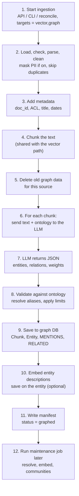

| Step | What happens | Example result |
|---|---|---|
| 1 | Ingestion starts. The `graph` target is enabled (`INGESTION_TARGETS=vector,graph`; it is off by default) | Run id `a1b2c3` |
| 2 | The file is loaded, checked, parsed to text and cleaned. Personal data is masked if `PII_MODE` is on. Duplicates are skipped | Clean text for documents 1 and 2 |
| 3 | A stable `doc_id` and the ACL are added | ACL `*` (everyone) |
| 4 | The text is split into chunks. The same chunks are used for the vector index | Chunk A and chunk B |
| 5 | Old graph data for this source is deleted, so re-runs never create duplicates | Clean slate for the source |
| 6 | Each chunk is sent to the utility LLM with the allowed types from `config/ontology.yaml` and a few examples | One LLM call per chunk |
| 7 | The LLM returns JSON | Chunk A: `Billing System (System)`, `IT Department (Organization)`, relation `IT Department OWNS Billing System`. Chunk B: `Acme Corp (Organization)`, `Billing System (System)`, relation `Acme Corp DEPENDS_ON Billing System` |
| 8 | Types are checked and remapped, aliases resolved, and the limits applied (25 entities, 40 relations per chunk) | The legal suffix is stripped, so "Acme Corp" is stored as the entity **"Acme"**. A later "Acme Inc." would land on the same node |
| 9 | The chunk, its entities and links are saved with merge. **"Billing System" from both chunks becomes one node** | See the graph below |
| 10 | Each entity description is embedded and saved for meaning-based entity linking | Optional; skipped if no embedder is configured |
| 11 | The manifest records the outcome | `graphed`, chunk and entity counts |
| 12 | Later, the maintenance job merges near-duplicate entities, rebuilds entity embeddings, and builds community reports | Used by global search |

**The graph after step 9**

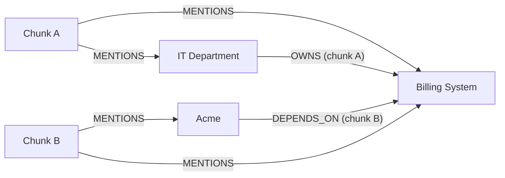

The two facts came from different documents, but they are connected because both mention the same entity.

### 10.2 Graph retrieval workflow

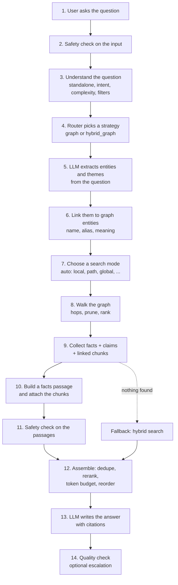

| Step | What happens | Example result |
|---|---|---|
| 1 | The question arrives at `/api/v1/chat` | "Who is responsible for the system that Acme Corp depends on?" |
| 2 | The input guardrail checks the question | Allowed |
| 3 | One cheap LLM call rewrites, classifies and extracts filters | Intent `rag`, complexity `relationship` |
| 4 | With `RAG_MODE=auto` and the graph modes enabled, the router maps `relationship` to the `graph` strategy | `graph` |
| 5 | An LLM pulls out the entities and themes | Entity: `Acme Corp`. Theme: `system ownership` |
| 6 | Entity linking finds matching graph entities the user may see (the name is normalised the same way as at ingestion) | `Acme` |
| 7 | With `GRAPH_SEARCH_MODE=auto`, one entity and no "between / related" wording, no big-picture words, entity plus theme found and a vector store available | Mode `dual` (local plus a small global search) |
| 8 | The local part walks up to `GRAPH_MAX_HOPS=2` links from `Acme`, keeps only the strongest links per entity, ranks entities with personalised PageRank | Path: Acme → Billing System → IT Department |
| 9 | It collects the facts found, claims about the seed entities (only if `GRAPH_EXTRACT_CLAIMS` was on at ingestion), and chunks that mention the seeds and the most central neighbours | Facts from chunks A and B. Chunks A and B |
| 10 | The facts are turned into one passage, listing the chunks they came from | See below |
| 11 | The context guardrail drops passages that look like prompt injection | None dropped |
| 12 | The assembler dedupes, reranks, applies the token budget and reorders | 3 or 4 passages kept |
| 13 | The chat model answers from the numbered passages and cites them | "The IT Department is responsible for the Billing System, which Acme Corp depends on. [1][2]" |
| 14 | A quality check scores support. With escalation on and low confidence, it retries with a stronger mode | High confidence, done |

**The facts passage built in step 10**

```
Knowledge graph facts:
- Acme (Organization): ...
- Acme -[DEPENDS_ON]-> Billing System: ...
- IT Department -[OWNS]-> Billing System: ...
```

Its metadata lists chunks A and B as `supporting_chunks`, so the answer's citations point to the real source text.

If the graph finds nothing at step 9, the strategy falls back to normal hybrid search (`GRAPH_SEMANTIC_FALLBACK=true`), so a graph miss does not mean no answer.

### 10.3 The two workflows side by side

| | Ingestion (ahead of time) | Retrieval (at question time) |
|---|---|---|
| Starts with | A document | A question |
| LLM use | Extract entities and relations from every chunk | Extract entities from the question, optionally score community reports, write the answer |
| Graph use | **Write** nodes and links | **Read** by walking links |
| Key result | A connected graph with shared entities | Facts plus source chunks |
| Cost driver | One LLM call per chunk | A few LLM calls per question |

---

## 11. Common questions

### 11.1 Do we need to embed the entity and relation data before storing it in the graph DB?

**No.** The graph DB stores entities and relations as structured nodes and edges (`Entity`, `RELATED {type, weight, chunk_id}`). Retrieval follows those links, so it does not need vector similarity.

Embeddings are used in a few places, as an optional extra:

| What | Embedded? | Where it goes | Purpose |
|---|---|---|---|
| Relations (edges) | **No** | Graph only | Found by walking links |
| Entity descriptions (`name (type): description`) | **Yes, optional** | On the entity documents (Atlas Vector Search) | Matching a question to an entity by meaning |
| Chunks | Yes | Vector store | Normal semantic and hybrid search |
| Community reports | Yes | Vector store | Global search |

**Order in the pipeline** (`_index_graph`):

1. Extract entities and relations with the LLM.
2. Save them to the graph (`upsert_chunk_graph`). Nothing is embedded yet.
3. Embed the entity descriptions (`_embed_entities`) and save them with `upsert_entity_embeddings`.

**What the entity embeddings are for.** At query time, entity linking first looks for matches by exact name, alias and partial name. If `similarity_linking` is on and an embedder is available, it also embeds the question and looks for similar entity descriptions (cosine similarity of at least 0.75).

- **When it runs:** only if name, alias and partial matching found fewer than 2 entities, and an embedder exists (which needs the vector store enabled).
- **Without them:** the graph still works, but it links entities by name or alias only. A question like "who handles staff holidays?" would not reach the "Annual Leave Policy" entity unless the wording matches.
- **No embedder configured:** `_embed_entities` returns immediately and ingestion continues.
- **Rebuilding them:** the `embed` task in `graph_maintenance.py` recomputes them later.
- **Not a substitute for chunk embeddings.** Chunks still go to the vector store, which the `hybrid` graph mode and `hybrid_graph` strategy rely on.

### 11.2 Is the output of graph retrieval a chunk, like the vector DB output?

**Partly.** Graph retrieval returns the same result type as vector search (`VectorSearchResult`), but it often returns more than chunks.

| Item | What it is | Where it comes from |
|---|---|---|
| **Facts passage** (first item) | A generated text block, "Knowledge graph facts:", with entity lines and `A -[REL]-> B: description` lines | Built from graph entities, relations and claims, not from a stored chunk |
| **Chunks** | Real text chunks that mention the matched entities | The graph's `chunks_for_entities` |
| **Community reports** (global, drift and dual modes) | LLM-written summaries of entity clusters, filtered to the points relevant to the question | Stored in the vector store as `kind=community` |
| **Cypher result** (cypher mode) | A pre-approved query's result becomes a facts passage; a free-form query's result is a small table | The graph DB |

How it differs from vector retrieval:

- **Selection:** vector search picks chunks by similarity to the question. Graph search picks chunks that mention entities reached by walking links, so a chunk can be returned even if its wording is not close to the question.
- **Facts passage metadata:** it has `source="knowledge-graph"`, `retriever="graph"` and a `supporting_chunks` list naming the chunks the facts came from, so the facts stay citable.
- **Scores:** a chunk's score is the share of the entity keys (matched entities plus up to 5 central neighbours) it mentions (the facts passage is fixed at 1.0), not a similarity score. Graph contexts are also exempt from the knee cutoff (`RETRIEVAL_KNEE_CUTOFF`, off by default).

All of these then go through the same assembler (dedupe, rerank, token budget, reorder) and reach the chat model as numbered passages with citations.

### 11.3 After entities are found in the graph, how is the chunk retrieved?

Through the **`MENTIONS` links** stored during ingestion. Each `Chunk` node is saved in the graph with its full text (`content`), `source`, `acl`, `doc_id` and `title`, and is linked to every entity found in it: `(Chunk)-[:MENTIONS]->(Entity)`. Retrieval follows those links in reverse, from entities to chunks.

There are two ways chunks are found:

1. **From entities to chunks** (the main way, `chunks_for_entities`). It finds chunks that mention any of the entity keys. The keys are the entities matched from the question plus the 5 most central neighbours from the graph walk, ranked by personalised PageRank.
2. **From facts to chunks** (citations). Each relation stores the `chunk_id` it was extracted from. When facts are turned into the "Knowledge graph facts" passage, those ids go into the `supporting_chunks` metadata.

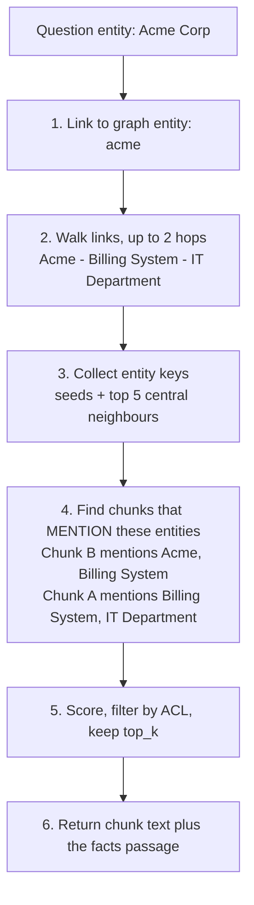

How chunks are scored and filtered:

- **Ranking:** the query counts how many of the entity keys each chunk mentions (`hits`) and orders by that count, highest first.
- **Score:** `hits / number of entity keys`, so only a chunk that mentions every key (seeds and neighbours) scores 1.0.
- **Permissions:** chunks whose ACL the user cannot read are dropped.
- **Limit:** only the top `top_k` chunks are kept. The query fetches 3 times that number first, to leave room for the ACL filter.

Key points:

- **No vector search is involved** in this step. The chunk is chosen by which entities it mentions.
- **The chunk text comes from the graph DB**, not from the vector store.
- **Other search modes use the same lookup:** `path` uses the entities on the found path, and the graph `hybrid` mode starts from vector hits and finds their entities with the reverse lookup (`entities_for_chunks`).

### 11.4 In hybrid retrieval, are the graph chunks and the vector chunks combined with RRF?

**Yes, in `hybrid_graph` mode.** The chunks from the hybrid search and the chunks from the graph search are fused with Reciprocal Rank Fusion. The graph's facts passage and community reports are not part of that fusion. Code: [hybrid_graph.py](../src/app/rag/strategies/hybrid_graph.py).

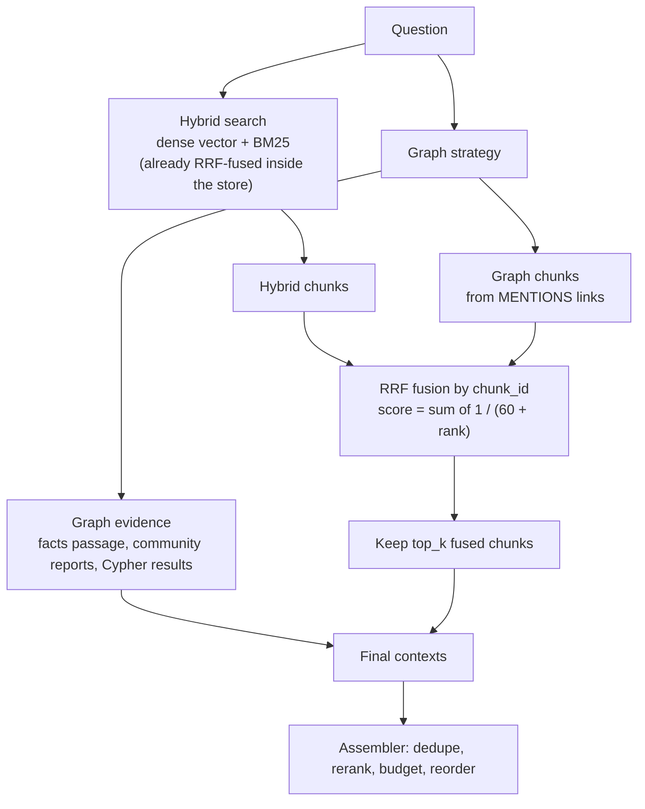

- **Parallel:** the hybrid search and the graph search run at the same time.
- **Two RRF levels:** the hybrid search already fuses its dense-vector and BM25 results inside the store. The graph chunks are then fused with that result.
- **Fusion by `chunk_id`:** a chunk found by both sides gets the sum of both reciprocal-rank scores (`1 / (60 + rank)`), so it rises to the top. This works because both stores use the same `chunk_id` for the same chunk. RRF uses rank only, so the different score scales of vector similarity and graph hit share do not matter.
- **Not fused:** the facts passage, community reports and Cypher results are kept at the front of the final list, so they do not take up slots meant for the top `top_k` chunks. The final order is `graph evidence + the top_k fused chunks`. (The assembler later keeps only the top `RETRIEVAL_RERANK_TOP_N` passages overall, so there they do compete.)
- **Best-effort graph side:** if the graph fails or finds nothing, only the hybrid chunks are used. The trace shows `graph_failed=true` when the graph side raised an error, and `graph_chunks=0` when it simply found nothing (database errors inside the graph search are caught there and look like "found nothing"). The graph strategy is built without a semantic fallback here, because the hybrid side already covers it.
- **After fusion:** the shared assembler dedupes, reranks, applies the token budget and reorders, as for every mode.

Other modes:

- **`graph` mode alone:** no RRF. It returns graph chunks, and falls back to hybrid search if it finds nothing.
- **Graph `hybrid` search mode:** this is a different kind of hybrid. Vector hits seed the graph, and the results are simply concatenated, not RRF-fused.

---

## Quick recap

1. **Ingest:** read documents, clean them, split into chunks, save chunks in the vector index, and have an LLM extract entities and relations into the knowledge graph.
2. **Maintain:** merge duplicates, group the graph into communities and write a summary report for each.
3. **Ask:** understand the question, pick a strategy (hybrid for simple facts, graph for relationships and big-picture, agentic for multi-step).
4. **Retrieve:** the graph strategy follows links between entities or reads community summaries, and `hybrid_graph` combines that with normal search.
5. **Answer:** pick the best passages, apply safety checks, and let the LLM write an answer with citations, respecting who may see what.
